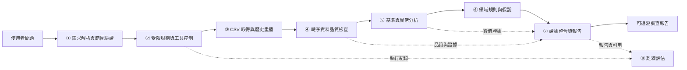
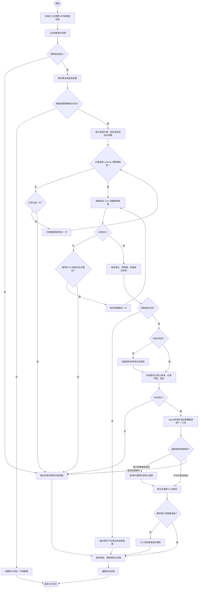

# Energy Detective：建築用電異常調查 AI Agent

組別：第25組

> 本文件為期末專題的**預定設計**。程式、工具、資料清理、模型與評估均尚未實作；未產生實驗結果。所有資料量、分割長度與數值門檻均為暫定設定，須在資料盤點及驗證集確認後固定。

## Problem

建築電表可記錄長期用電，但使用者仍需逐一檢查異常時間、比較歷史型態，並整理可能原因。Energy Detective 預計讓使用者提出「某棟建築最近有哪些值得調查的用電異常？」後，由 Agent 規劃受限分析、呼叫 Python 工具，回傳含時間、數值、證據與後續查核建議的報告。

研究問題是：在無真實設備故障標籤的公開時序資料上，能否以可重現的統計分析與受限工具，讓 Agent 完成可追溯的用電異常初步調查？本專題不以判定設備故障或估計已實現節電量為目標。

## Requirements

- 使用 Building Data Genome 2（BDG2）公開建築電表及對應天氣時序資料；先選一棟建築，再視時間擴充少量建築。來源網址、授權與欄位定義須於下載時核對並記錄。來源查核見 [domain_research.md](research/domain_research.md) 的 D3–D6。
- 以歷史 CSV 重播模擬 IoT 資料流，保留時間戳、量測值、建築／電表識別與場址天氣關聯；不要求實體感測器或即時部署。
- 支援單一目標：調查指定建築與時間範圍的用電異常。需求不足時回傳缺少的欄位，不任意換棟或擴大期間。
- 資料品質與分析結果由 Python 工具計算；LLM 不自行編造量測值、門檻、工具結果或設備根因。
- 每個結論必須指向可定位的證據紀錄；資料不足、工具失敗與天氣缺漏須明示。
- 只允許已定義的讀取、分析與報告工具，不執行模型生成的任意 Python、Shell 或控制設備。

## Architecture



### Components

| 編號 | 預定模組 | 職責與邊界 |
|---|---|---|
| ① | 需求解析與範圍驗證 | 將自然語言轉為 `building_id`、`start`、`end`、調查目標；核對可用建築與期間，缺值即回覆待補資訊。 |
| ② | 受限規劃與工具控制 | LLM 從固定工具與允許參數產生結構化計畫；控制器驗證依賴、資料範圍、呼叫預算及重試。分析後 LLM 依品質／事件觀察決定適用規則或跳至報告，控制器再次檢查。 |
| ③ | CSV 取得與歷史重播 | 依設定讀取本機公開資料子集，解析原始欄位及建築／場址對照，只提供重播截止點以前的資料。 |
| ④ | 時序資料品質檢查 | 檢查時間格式、重複、缺值、時距、非有限值、負值、單位與天氣對齊；輸出品質摘要及可分析遮罩。 |
| ⑤ | 基準與異常分析 | 以訓練期建立統計基準，以校準期固定警示門檻，再評估保留測試期；輸出偏差及候選異常事件。 |
| ⑥ | 領域規則與假說 | 將事件與歷史同時段、使用者提供的作息及同時天氣對照，產生需人工查核的假說與適用條件。 |
| ⑦ | 證據整合與報告 | LLM 將工具證據寫成繁中報告；程式驗證數值與證據 ID，無法驗證時改用固定模板。 |
| ⑧ | 離線評估 | 以保留時段、人工注入異常及固定問題案例，分別評估統計分析與 Agent 執行品質。 |

### 工具輸入與輸出

所有工具皆回傳 `status`（`ok`／`insufficient_data`／`error`）、`evidence_ids`、`warnings`；失敗時另回傳 `error_code` 與是否可重試。以下為預定介面。

| 工具 | 輸入 | 主要輸出 |
|---|---|---|
| `inspect_dataset` | 本機 `dataset_id` | 可用建築、電表種類、期間、單位／時區來源、檔案版本摘要 |
| `load_window` | 建築 ID、訓練／校準／測試日期、`replay_until` | 正規化電表與天氣表、原始列定位、資料清單 |
| `check_quality` | 資料表參照、預定取樣時距 | 缺值率、重複／衝突、負值、間隔統計、有效資料遮罩、可分析與否 |
| `analyze_energy` | 品質合格的資料參照、固定分割與門檻設定 | 預測基準、殘差、點異常、連續事件、MAE、各事件數值證據 |
| `apply_domain_rules` | 事件、歷史摘要、對齊天氣、可選作息、允許的 `rule_ids` | 規則 ID、符合條件、支持與缺少的證據、假說、查核建議 |
| `build_report` | 需求、執行紀錄、已登錄證據 | 報告草稿、引用清單、限制、驗證狀態或固定模板報告 |

工具只接受已登錄的本機資料 ID／表格參照，拒絕任意檔案路徑、URL、SQL、程式碼與未知工具。`inspect_dataset` 先確認可用資料，再執行後續工具；品質檢查與分析為必要依賴，領域規則為受前置條件約束的可選步驟。

可規劃的選擇為資料期間內的查詢範圍、關注偏高／偏低／兩者，以及是否啟用 `historical_deviation`、`schedule_check`、`weather_context`、`zero_run_check`。分析的時間切分與統計門檻由固定實驗設定決定，LLM 不可變更。取得事件後，Agent 依觀察修訂計畫：無事件可直接報告；缺天氣就排除 `weather_context`；缺作息或可靠當地時間就排除 `schedule_check`；零值事件可選 `zero_run_check`。選擇理由與被跳過規則均記錄。執行器使用計畫中的工具名／參數實際呼叫工具，不只把計畫印出；不合法選擇則停止或以已驗證證據產生受限報告。

## Data Flow

原始 CSV → 正規化量測表／天氣表 → 品質旗標 → 時間分割 → 歷史基準與候選事件 → 領域規則 → 證據清單 → 調查報告。重播只代表限制可見時間，不宣稱即時 IoT 串接完成。

主資料預定選作者 repository 的 `data/meters/raw/electricity.csv`，搭配 `data/weather/weather.csv` 與 `data/metadata/metadata.csv`。BDG2 的 raw 仍已經初步處理，不能稱為完全未處理的感測器封包；cleaned 另移除了部分離群及零值，故不用來代表完整異常觀測。資料來源與兩版本差異見 [BDG2 repository](https://github.com/buds-lab/building-data-genome-project-2) 及 [Meters data features](https://github.com/buds-lab/building-data-genome-project-2/wiki/Meters-data-features)。本次最低實作只跑 raw；如呈現 cleaned 比較，須標成獨立敏感度分析，不能取代主測試。

### 預定資料契約

- 電表：`timestamp`、`building_id`、`meter_id`、`value`、`unit`；保存原始檔名及列／欄定位。原始寬表由匯入器轉為長表。來源電力資料說明為逐時 kWh，匯入時仍核對檔案與欄位，正規化後不可混入其他種類計量表。
- 天氣：`timestamp`、`site_id`、`air_temperature`、溫度單位與原始定位；以建築的場址對照連結。
- 設定：欄位對照、資料版本、單位、時間標記語意／時區及來源。若資料未提供時區，不自行當成 UTC；以來源原始時間軸分析，標示未知時區，停用需確定當地時間的作息規則。
- 證據：`evidence_id`、工具名、參數、資料版本、建築／電表、期間、計算方法、數值與單位、原始資料定位、品質警告。報告引用同一份唯讀證據清單。

### 品質與失敗處理

不對缺失量測補零，也不插補測試期用電以產生異常。相同時間的相同數值可去重並留下紀錄；數值衝突則標記並排除。負值先列為品質疑點，依該資料的單位與量測語意決定是否可分析，不直接當成設備故障。天氣只做同場址、同時刻對齊；缺漏時保留用電分析，停用相關天氣解釋。

預定至少使用連續 12 週：前 8 週訓練、後 2 週校準、最後 2 週測試。暫定每段用電有效率至少 90%，且訓練期每個小時／星期組別至少 4 個有效觀測；不足則回傳資料不足。這些條件是專題設定，並非建築能源領域公認標準。所有設定於查看測試結果前固定。



每次執行預定最多 10 次工具呼叫，包含最多一次暫時性 I/O 重試；計畫格式最多修正一次。欄位缺漏、檔案不存在、品質不足或演算法錯誤不盲目重試。達預算上限即停止並留下已取得證據，避免 Agent 無限循環。

## AI Model

預定使用一個支援結構化輸出的文字 LLM，模型名稱與版本由環境設定提供，於實驗時固定並記錄。LLM 用於需求解析、受限計畫與文字整理；不訓練大型模型、不以 LLM 直接預測電量。

計畫輸出限制為 `goal`、`building_id`、日期、關注方向、工具、參數與候選規則。工具白名單、依賴順序、呼叫上限及輸出 schema 由程式強制執行。分析完成後僅允許一次依觀察調整的工具決策：呼叫適用的 `apply_domain_rules` 或直接 `build_report`。所有報告數值必須取自結構化證據欄位；證據不存在、單位不同或數值對不上時驗證失敗，改由模板輸出。資料不足時允許沒有異常結論。

## Domain Knowledge

領域知識以明確規則實作，不以一段不可檢查的提示詞取代計算。

| 規則 | 可觀察證據 | 可輸出的解釋／行動 | 必須保留的限制 |
|---|---|---|---|
| 同星期、同小時比較 | 實際值、歷史基準、偏差、持續時間 | 某些時段偏離歷史型態，建議核對活動或運轉紀錄 | 歷史型態不等於正常標籤 |
| 非使用時段用電偏高 | 使用者提供的作息、時區、時段用電與基準 | 建議確認加班、排程與待機負載 | 無作息或可靠當地時間即停用；不自行假設週末停工 |
| 天氣背景 | 同時刻氣溫及訓練期氣溫分布 | 高／低溫可能提供背景，建議查核空調運轉紀錄 | 共現不是因果；不由總表認定空調故障 |
| 突然下降／長段零值 | 有效值、缺測旗標、連續長度 | 建議先核對資料傳輸、建築停用或供電紀錄 | 零值可能是真實停用，不能直接判定斷電 |

「高／低溫」暫以訓練期溫度分位數描述，分位數及事件連續長度皆須在校準前登錄。所有規則先列品質限制，再列支持與缺少的證據，最後才給查核建議。各項原因只列為待驗證假說。

## Algorithm

### 統計基準與異常

最小基準 B0 為訓練期全域用電中位數；主要方法 B1 為訓練期同「星期幾 × 小時」的中位數。兩者均不讀取校準期／測試期來擬合基準。天氣在本次最低實作中用於背景規則，尚不納入預測模型，以控制實作範圍。

對有效時間點計算殘差 `r_t = y_t - baseline_t`。以校準期 `abs(r_t)` 的第 99 百分位作為暫定絕對偏差門檻；只在測試期以 `abs(r_t) > threshold` 標記候選異常。門檻為零時改用預先設定的單位相關最小解析度；若來源無法確認解析度則回傳不可校準，不臨時猜值。保留正負方向、偏差量與觀測值；相鄰且同方向的候選點合成事件，遇缺測或方向變化即中斷。單點保留為單點事件，避免事後依測試結果刪除難偵測事件。

事件偏差總和只有在確認量測為固定間隔電能時才以該電能單位相加；若為功率則依已驗證取樣間隔積分。未確認單位時停止分析，不把功率、電能與累積讀數混用。偏差量是相對基準的估計差異，不是已確認的浪費或可節省電量。

### Algorithm 1：Energy Detective 受限異常調查演算法

**Input：**使用者問題 `question`、固定資料與實驗設定 `config`、歷史重播截止點 `replay_until`。

**Output：**可追溯調查報告與證據／執行紀錄；或明確的待補資訊、資料不足、失敗狀態。

以下為帶行號的專屬 Pseudocode：

```text
01 PROCEDURE INVESTIGATE(question, config, replay_until)
02   INIT_GUARD(tool_budget = 10, io_retry_used = FALSE, allowed_tools)
03   manifest ← GUARDED_CALL(inspect_dataset, config.dataset_id)
04   IF manifest failed THEN RETURN FAILURE_WITH_LOG(manifest.error)
05   request ← PARSE_AND_VALIDATE(question, manifest)
06   IF request lacks building or dates THEN RETURN NEED_INPUT(request.missing)
07   plan ← LLM_PLAN(request, manifest, fixed_config, dependency_constraints)
08   IF plan invalid THEN plan ← REPAIR_ONCE(plan, validation_errors)
09   IF plan invalid THEN RETURN FAILURE_WITH_LOG("invalid_plan")
10   data ← EXECUTE_GUARDED(plan.load_window)
11   IF data is transient_io_error AND NOT io_retry_used THEN
12       io_retry_used ← TRUE; data ← EXECUTE_GUARDED(plan.load_window, same_parameters)
13   IF data failed THEN RETURN FAILURE_WITH_LOG(data.error)
14   quality, valid_rows ← EXECUTE_GUARDED(plan.check_quality, data_reference)
15   IF unit/time_axis unresolved OR coverage insufficient THEN
16       RETURN INSUFFICIENT_DATA_REPORT(quality)
17   result ← EXECUTE_GUARDED(plan.analyze_energy, valid_rows, fixed_config)
18   INSIDE analyze_energy:
19       train, calibration, test ← CHRONOLOGICAL_SPLIT(valid_rows, fixed_dates)
20       ASSERT max(train.time) < min(calibration.time)
21       ASSERT max(calibration.time) < min(test.time) AND max(test.time) ≤ replay_until
22       FOR method IN [GLOBAL_MEDIAN, HOUR_OF_WEEK_MEDIAN]
23           baseline ← FIT_ONLY_ON_TRAIN(method, train)
24           residual_cal ← calibration.value - PREDICT(baseline, calibration.time)
25           threshold ← QUANTILE(abs(residual_cal), config.q)
26           IF threshold = 0 THEN threshold ← VERIFIED_METER_RESOLUTION_OR_FAIL()
27           residual_test ← test.value - PREDICT(baseline, test.time)
28           flags ← abs(residual_test) > threshold
29           events ← GROUP_ADJACENT_SAME_DIRECTION(flags, sign(residual_test), break_on_missing = TRUE)
30           REGISTER_EVIDENCE(method, threshold, events, quality, data.source_rows)
31   IF result failed THEN RETURN FAILURE_WITH_LOG(result.error)
32   eligible ← RULES_ALLOWED_BY(result.events, weather, schedule, timezone)
33   next ← LLM_NEXT_STEP(plan, quality, result, eligible)
34   IF next is invalid OR exceeds dependency/budget THEN RETURN RESTRICTED_REPORT_WITH_LOG()
35   IF next.tool = apply_domain_rules THEN
36       rules ← EXECUTE_GUARDED(next, rule_ids subset_of eligible)
37   ELSE ASSERT next.tool = build_report; RECORD_SKIPPED_RULES(next.reason)
38   evidence ← FREEZE_EVIDENCE_STORE(result, rules_if_any, quality, tool_log)
39   report ← GUARDED_CALL(build_report, request, evidence, require_evidence_ids = TRUE)
40   IF NOT VALIDATE_REFERENCES_AND_NUMBERS(report, evidence) THEN
41       report ← DETERMINISTIC_TEMPLATE(request, evidence)
42   SAVE(report, evidence, config, tool_log)
43   RETURN report
44 END PROCEDURE
```

第 02 行先初始化共用工具預算，包含第 03 行的資料清單檢查。第 10–12 行只允許同參數的一次 I/O 重試；所有工具共用包裝器，預算用盡便回傳帶紀錄的失敗。第 17 行執行已驗證計畫，第 32–37 行再依觀察選擇可選工具與規則。B0 與 B1 使用同一時間切分；報告以 B1 的事件為主，保留 B0 的評估結果。未合格的組別不以測試期補算。

所有提前回傳的報告／失敗輔助函式都先保存目前證據、狀態及執行紀錄。可選規則工具失敗時記錄該規則不可用，僅以既有分析證據產生受限報告，不虛構規則結果；報告工具失敗則直接使用固定模板。

## Implementation Mapping

以下為**預定程式配置，目前尚未建立或執行**。

| 預定檔案 | 對應模組／pseudocode | 預定實作 |
|---|---|---|
| `config/experiment.json` | ①②、01–09 | 資料 ID、欄位與單位對照、時間分割、門檻、模型、工具預算 |
| `src/agent.py` | ①②⑦、05–09、32–39 | 結構化需求與計畫、白名單、依賴檢查、依觀察決策、報告生成 |
| `src/data.py` | ③、03、10–13 | CSV 轉長表、場址對照、可見時間限制、原始定位 |
| `src/quality.py` | ④、14–16 | 品質旗標、有效遮罩、資料不足輸出 |
| `src/analysis.py` | ⑤、17–30 | 時間切分、B0／B1 基準、校準門檻、測試殘差與事件 |
| `src/rules.py` | ⑥、32、35–37 | 作息與天氣等條件式規則、適用前提、假說限制 |
| `src/evidence.py` | ⑦、30、38–42 | 證據 ID、數值／引用驗證、固定報告模板 |
| `src/evaluate.py` | ⑧ | 時序指標、合成注入、Agent 固定案例評分 |
| `src/main.py` | ①至⑦ | CLI 入口、工具包裝器、重試與執行紀錄 |

### 評估設計

1. **時間與資訊隔離：**先依時間固定訓練／校準／測試，不隨機打散。所有統計量、氣溫背景分位數與欄位處理策略只用訓練資料決定；異常門檻只用校準資料決定。不得根據測試表現挑建築、改門檻或移除不利時段。資料選取依欄位完整與覆蓋條件，記錄排除理由。
2. **基準比較：**B0 與 B1 使用相同有效測試時間點，比較 MAE（原單位）、有效資料覆蓋率、警示點數及事件數。MAE 只表示用電型態擬合誤差，不代表故障診斷能力；無真實標籤時不把未警示點算成正常點。
3. **合成異常獨立實驗：**保留原始測試集不變，另複製測試資料，以固定亂數種子在有效且不重疊的區間注入尖峰、持續增加、連續零值，預定各類 10 個事件。尖峰預定 1 小時、持續增加 4 小時、零值 6 小時；前兩類幅度預定為訓練期中位數的 50%／100%，各 5 件。若訓練中位數為零，停止該比例實驗並揭露原因；可用區間不足則揭露實際件數，不越界注入。所有方法使用相同注入，基準及門檻皆不重訓。注入點命中率＝注入區間內被標記點數／全部有效注入點；事件命中＝注入區間內至少一點被標記；事件命中率＝命中事件／實際注入事件。事件漏失為區間內完全無警示，首次命中延遲為第一個區間內警示時間減注入開始時間，漏失事件延遲記 N/A，分開報漏失件數，不填成零或排除後聲稱全體延遲。原本已警示的點另標示，避免將原有警示全歸功於注入。非注入區間的新增警示數只作隔離／實作檢查：固定基準與門檻下理應不變，不能當作模型品質或誤報指標。原始資料可能已有真異常，因此不宣稱真實故障 precision／recall；合成結果只顯示指定擾動敏感度。
4. **Agent 評估：**預先編寫 10 個固定案例：一般調查 3、缺建築／期間 2、覆蓋不足 1、天氣缺漏 1、一次暫時性讀取失敗 1、未知工具／越界參數 1、無證據根因要求 1。固定資料、模型版本與提示詞，各跑 3 次，分別報告完整流程與各案例結果。任務成功需完成預定路徑，或在預期失敗案例正確停止；不能把無法分析一律算成功。
5. **證據與安全邊界指標：**報告可追溯率＝有有效證據 ID 且數值／單位相符的事實陳述數 ÷ 全部事實陳述數（無事實時記 N/A）；另報工具成功率、任務成功率、錯誤後正確停止率、預算遵守率、未支持根因陳述數與人工審閱結果。證據驗證以結構化主張檢查配合逐份人工審閱，避免只驗證 ID 存在而漏掉語意錯置。
6. **報告與規劃效益比較：**採三組：固定 Python 報表、固定流程＋LLM、受限規劃 Agent。三組使用相同問題、資料、分析工具及 B1 計算；Python組以既有固定模板呈現所有適用工具結果。後兩組使用同一模型與報告提示詞：固定流程依預寫分支取得所有適用工具結果，再交 LLM 報告；Agent 則以受限計畫及一次觀察決策選擇適用工具。Agent 額外的規劃提示詞與決策輸出另行保存。三組可取得相同證據，不刻意剝奪對照組資料。比較任務成功、工具呼叫數、數值正確、事實可追溯率、必要資訊完整度與未支持根因數，記錄實際結果／上下文差異。Python組對固定流程＋LLM用於觀察文字生成差異，固定流程＋LLM對Agent用於觀察規劃差異；不預設 Agent 較佳，也不將分析 B0／B1 的差異當成 Agent 效益。

預計展示一份一般異常調查、一份資料不足回覆及一份合成異常比較表。上述為預定評估，不預設性能改善、節電或零幻覺結果。

### 簡短實作時程與最低依賴

| 階段 | 預定工作與可檢查產物 |
|---|---|
| 第 1 週 | 核對 BDG2 欄位、單位、授權與時間語意；固定單棟子集、設定與品質報告 |
| 第 2 週 | 完成 B0／B1、校準與事件合併；產生可重現數值證據 |
| 第 3 週 | 串接受限 Agent、領域規則、引用驗證與報告模板 |
| 第 4 週 | 跑固定時序與合成評估、10 類案例，整理展示與限制 |

最低預定依賴為 Python、`pandas`、`numpy`、`pydantic` 及單一 LLM 供應商的 Python SDK。CSV、JSON 與 Markdown 存本機；不需向量資料庫、微調框架、雲端 IoT 平台或 Web 服務。實作時固定 Python／套件版本並保存依賴清單；API 金鑰由環境變數提供。

## How to Run

**尚未實作，下列是預定介面，現在不可作為可執行完成品操作。** 先依核對後的來源下載單棟資料，建立欄位、單位與時間分割設定，再執行：

```powershell
# 預定；requirements.txt、設定與 src 程式均尚未建立
python -m pip install -r requirements.txt
python -m src.main --config config/experiment.json --question "請調查指定建築測試期間的用電異常"
python -m src.evaluate --config config/experiment.json
```

預定輸出 `outputs/<run_id>/report.md`、`evidence.json`、`tool_log.json` 及 `metrics.json`；包含資料版本、完整參數與模型版本，以利重現。資料或 API 不可用時應產生清楚的失敗紀錄。

## Results

**尚未進行實驗，沒有實測結果。** 目前僅提出系統、工具介面、演算法與評估方法。MAE、合成異常命中率、Agent 成功率及證據可追溯率均待實作後計算，不填入預期數字當作成果。

## Limitations

- 總表缺少設備級狀態與維修紀錄，無法確認是哪個設備故障，也不能證明實際節電。
- BDG2 子集與歷史重播不等於當地建築的即時系統；不同氣候、作息與資料品質的外推能力尚待驗證。
- 以歷史中位數與固定校準門檻偵測偏差，可能受營運變動、既有異常、假日及季節變化影響；最低版本不自動學習所有變動。
- 無真實故障標籤，原始資料的異常判斷與假說需人工查核；合成擾動不能代替真實設備故障測試。
- 天氣與用電的共現僅作背景；作息未提供或當地時間不確定時，相關規則停用。
- LLM 仍可能產生語意錯誤；結構化工具、證據驗證與模板降級降低風險，人工審閱仍屬評估的一部分。

## 最低範圍與擴充邊界

| 項目 | 必做的最低版本 | 後續擴充 |
|---|---|---|
| 資料 | 單棟 raw electricity、場址天氣與 metadata；歷史重播 | 多棟／多場址、cleaned 敏感度、實體 IoT |
| 分析 | B0/B1、校準殘差、連續事件、合成注入 | 天氣條件預測、通用模型、季節漂移偵測 |
| Agent | 結構化需求、固定依賴、一次觀察後決策、證據驗證 | 多輪主動蒐證、工單或設備知識圖譜 |
| 驗證 | 十個案例、三組比較、人工語意核對 | 設施人員使用者研究、真實故障與節電驗證 |

## 查詢、工具與報告契約補充

日期採半開區間 `[start, end)`。使用者可選擇預先登錄測試期內的呈現範圍；訓練／校準邊界由固定設定提供，不隨提問改變。不在測試期內的請求回覆可用範圍，不自動改寫問題。LLM 不可改動品質或異常門檻。

使用者提問、資料描述和來源文字都是待處理資料，不可覆寫工具白名單、固定設定或預算。模型供應商與確切版本在實驗前登錄；若版本未知則記錄供應商實際回傳識別，不能聲稱位元級可重現。用量、重試與模板降級皆入紀錄。

工具回傳至少含 status、error_code、retryable、evidence_ids、warnings、data_reference。資料表不直接塞入 LLM；只提供有上限的事件摘要與品質統計。完整數值保存在 evidence store，報告的數值主張以 evidence_id 和 field 指向證據；顯示時才四捨五入。驗證須比對建築、期間、單位及值，不能只檢查 ID 存在。

領域規則的 rule_id、版本、來源、前置條件、支持證據、缺少證據與查核建議一起保存。高／低溫背景暫採訓練期第 90／10 百分位；零值規則暫以至少 6 個相鄰有效逐時零值為觸發。這些是待校準的工程設定，不是故障判定標準；固定於測試前，缺天氣／可靠作息即停用對應規則。

### 說明用合成案例

以下數字完全是教學假設，沒有來自 BDG2 實驗：四個連續小時各觀測 180 kWh，B1 各為 120 kWh，已固定門檻為 30 kWh，所有點有效且同方向。每點殘差為 60 kWh，大於門檻；合併為四小時事件，偏離總和為 240 kWh。來源標示 `illustrative_only`，不得混入實驗結果。

報告範例：「這四個時段高於歷史同星期／小時基準，累計偏離 240 kWh。尚缺營運排程及設備狀態，可能與活動增加或運轉排程改變有關；請查閱相同時段的使用及設備紀錄。」不能寫成「空調故障，已節省 240 kWh」。若第三小時缺值，不能補零或跨缺口合併，也不能再聲稱有完整四小時證據。

## 驗收協議與交付對應

研究問題、選樣、指標分母、十個案例、三組公平比較、人工審閱及結果表見 [實驗協議](research/evaluation_protocol.md)。原始資料無故障真值，因此不報真實故障 precision/recall；最低版本也不宣稱天氣校正或跨建築效能。

作業逐項對照與 Final Handover 待完成項目見 [交付核對](docs/acceptance.md)。完成文件不代表 Agent 程式、實驗、Final PPT 或 YouTube Demo 已完成。
