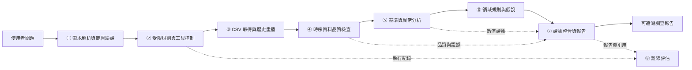
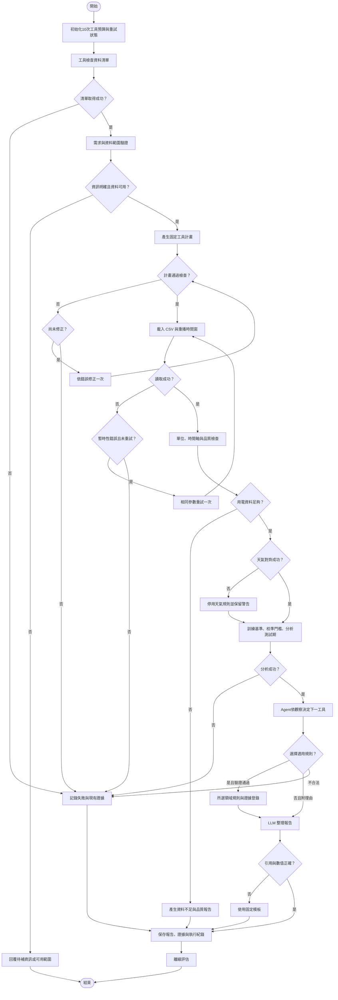

# Energy Detective：建築用電異常調查 AI Agent
## Final Project Proposal
課程：物聯網數據分析與應用｜階段：Proposal（占課程成績 10%）
組員／學號：繳交前填入｜日期：2026-11-03

## 1. Abstract 摘要
### A. Attention Getter — Motivation
IEA《Global Energy Review 2026》指出，2025 年全球用電需求增加約 3%，建築部門占用電增量近 45%。[D1] 建築能源管理需要把既有量測資料轉為可供追查的資訊；全球需求成長本身不代表個別建築存在浪費。
### B. But — Challenge
單純異常分數無法辨別天氣、營運變化與資料問題；總表資料也不足以確認設備根因。BDG2 cleaned 版本會移除部分離群與零值，且不提供本專題所需的現場根因真值。[D3][D6] 既有建築 LLM 工具研究亦出現查詢、分析與回答遺漏問題。[A4]
### C. Cure — Proposed Solution
為處理上述問題，本專題提出 Energy Detective 建築用電異常調查 AI Agent，讓管理者以自然語言指定建築與期間，取得附有數值、來源、適用規則及下一步查核事項的調查報告。
### D. Development — Method
系統擬使用 BDG2 歷史電表、天氣與建築中繼資料；由 Python 執行品質檢查、條件基準及異常事件分析，由受限規劃 Agent 選擇工具，並以明示領域規則約束推論。每項結論回連工具結果，資料不足時要求補充或回報無法判定。
### E. Experiments — Evaluation
以按時間切分的建築子集進行歷史重播，分開評估正常基準、合成事件與人工審閱案例；比較統計／預測方法及固定流程與 Agent。量測預測誤差、事件偵測、任務完成、證據正確性及成本。合成異常只驗證對指定擾動的敏感度，不代替真實故障標籤。
### F. Findings — Expected Outcomes
預期完成可重現的資料調查原型與附證據報告，並透過比較實驗確認 Agent 是否有助於調查完整度及限制過度推論。本階段尚未執行實驗；不宣稱提高準確率、證實設備故障或達成節電。

## 2. Introduction 緒論
### A. Attention Getter：公開證據與研究動機

IEA《Global Energy Review 2026》估計，2025 年全球用電需求增加約 3%，建築部門占當年全球用電**增量近 45%**。這個比例是增量占比，不能解讀成建築占全球用電總量 45%。[D1] IEA《Electricity 2026》進一步預測，建築部門將占 2025–2030 年新增用電需求的 49%；這是預測，不能當成已發生的結果。[D2]

用電需求成長使建築營運分析更具重要性，但上述全球統計不能證明任何單棟建築正在浪費能源。本專題因此聚焦較可驗證的問題：能否用既有電表與天氣資料，產生值得管理者追查、且能回到資料核對的異常調查建議？

### B. Background：領域、使用者與技術

目標使用者設定為校園／辦公建築的設施管理者與能源管理人員；這是本專題的使用情境設定，尚未經使用者訪談驗證。能源管理資訊系統（EMIS）將量測資料整理成營運資訊；故障偵測與診斷（FDD）則通常需要設備或系統運轉證據。LBNL 的 Smart Energy Analytics Campaign 報告涵蓋 104 個組織、6,500 棟建築，說明資料整理、分析與改善流程具有實務價值。[D7]

本專題採用 Building Data Genome 2（BDG2）。原始資料來自北美與歐洲 19 個場址，涵蓋 1,636 棟非住宅建築、3,053 個各類計量表、2016–2017 年每小時資料，另附建築中繼資料與天氣資料。3,053 是各類計量表總數，不能稱為 3,053 個電表。[D3] 本專題只選電力資料，以自然語言提問啟動資料查詢、數值分析及建議整理；LLM 不直接取代數值計算。

### C. Problem：待解決問題

管理者看到「週末用電變高」時，仍需判斷比較期間是否合理、氣溫是否不同、資料是否缺漏，以及下一步應查營運排程還是電表。由圖表或異常分數走到可執行的調查，存在一段需要領域判讀的工作。

本研究問題設定為：**在只有建築總表、天氣與有限建築資訊的情況下，結合分析工具、明示規則與 LLM，是否能比固定報表或固定流程搭配 LLM，產生數值正確、證據完整且不過度推論的調查建議？**這是待驗證假設，不預先宣稱 AI Agent 優於既有方法。

### D. Existing Limitations：現有方法與資料的限制

1. **相同高耗電可能有不同解釋。**天氣、使用人數和營運條件會影響比較基準；DOE 的整棟建築量測與驗證方法也要求考慮這些變動。[D8] 因此，單一固定門檻不足以支持設備根因判斷。
2. **資料清理會改變研究對象。**BDG2 的 raw 已經過初步整理；cleaned 又將偵測出的離群值、特定連續零值與電力零值替換為缺值。[D3][D6] 若直接在 cleaned 上研究異常，部分欲偵測的現象可能已被移除。
3. **公開總表沒有充分的現場答案。**BDG2 可供能源分析與異常研究，但不能把統計偏離自動當成經維修確認的設備故障。本專題不假定具有真實故障根因標籤；採人工審閱和明確標示的合成事件分別評估。
4. **異常電量不等於可實現節電。**實際節電需要改善前後的量測與合理基準。整棟建築層級驗證也不能分別確認每項改善措施的效果。[D8] 本專題無介入施工或運轉控制，因此不報告實現節電率。

### E. Innovation：本專題擬議創新

創新定位為「可追溯的調查流程」，不宣稱發明新的異常偵測演算法或全球首創。Agent 依提問選擇資料品質檢查、同時段比較、天氣條件比較與事件摘要等工具；數值由程式產生，LLM 將結果連結到適用的領域規則。

每則建議固定包含「觀察事實 → 比較基準 → 可能解釋 → 尚缺證據 → 下一步查核」，並附資料期間、工具結果識別碼與規則來源。例如，只有在標示營運時段假設後，才把夜間負載上升列為排程查核線索；無法確認營運時段時，應先要求查閱排程紀錄。規則是可撤回的調查假設，不是故障定論。

### F. Contributions：預期貢獻

- 一個以公開歷史電表資料重播的建築用電調查原型，驗證工具使用與調查流程的可行性。
- 一套保留品質旗標、來源與假設的證據格式，讓管理者能核對每個數字和建議。
- 一項比較固定報表、固定流程搭配 LLM 與工具支援 Agent 的評估，分開檢查事件偵測、數值正確性、證據覆蓋與過度推論；是否改善須由後續結果回答。

本階段限於 Proposal，尚未實作或證明上述貢獻。

## 3. Related Work 相關研究

本章以五篇 AI 研究及四份領域研究／指南對照，兼顧 AI Technology 與 Domain Know-how。

### 從回答問題到執行調查工具

ReAct 將語言模型的任務規劃、外部動作與觀察結果交替串接。作者在問答、查證及互動環境中顯示此流程的價值，但也觀察到重複動作及無效檢索造成的失敗。因此，Agent 的關鍵是根據工具回傳的證據調整行動；僅把電表摘要交給 LLM 改寫，尚不足以構成此類調查流程。[A1](https://arxiv.org/html/2210.03629v3)

在建築領域，Mulayim 等人已示範 GPT-4o 透過 Brick 語意模型查找資料，再產生 Python 程式分析 BAS 時序。其實驗也出現查詢錯誤、程式索引錯誤及回答遺漏感測器的情形。**本專題解讀：**建築資料分析 Agent 已有先例，本提案應強調異常調查流程與證據驗證，而非宣稱首次將 LLM 用於建築分析。[A4](https://eta-publications.lbl.gov/sites/default/files/2025-07/extraction_and_analysis_of_time_series_data.pdf)

### 數值偵測、領域知識與 LLM 的分工

Argos 使用 LLM 產生可執行規則，透過修復、審查及與既有偵測器融合來辨識雲端監控異常；它說明了可重現計算與語言模型協作的可行性。不過，規則學習需要已標註案例，且其驗證領域不是建築。**本專題解讀：**可借用「規則作為可檢查中介」的思想，但不能把其結果或 accuracy guarantee 當成 Energy Detective 的保證。[A2](https://arxiv.org/html/2501.14170v1)

Yang 等人讓多模態 LLM 複核傳統偵測器提出的候選異常，使用曲線圖與資料產生背景判斷誤報。全文結果呈現誤報降低與真異常保留率之間的取捨，並非普遍維持召回率。**本專題解讀：**應同時評估誤報與漏報，保留原始偵測結果及 LLM 的複核紀錄；不可只以回答流暢或告警減少認定系統改善。[A3](https://arxiv.org/html/2503.21833v1)

### 從異常標籤走向有證據的說明

Time-RA 將異常類別與文字說明納入時序任務，提出 RATs40K 與模型微調評估。這支持本專題將「異常在哪裡、屬於何種模式、憑什麼判斷」分開呈現。不過，該資料的說明包含 AI 輔助標註；能產生符合標註的解釋，不等於證實物理因果。**本專題解讀：**建築總表的高負載只能構成進一步調查線索，不能直接證明某設備故障。[A5](https://arxiv.org/html/2507.15066v1)

### AI Article Summary Table

表中的 Findings 均為作者結果；Limitation 若標示「外推限制」，代表本提案對研究適用範圍的判斷。

| Ref | Year | Problem | AI Method | Domain Knowledge | Dataset | Findings | Limitation |
|---|---|---|---|---|---|---|---|
| [A1](https://arxiv.org/html/2210.03629v3) ReAct | 2023；初稿 2022 | 單靠內部推理難以取得外部事實及更新行動 | 少量示例提示；交替進行任務推理、動作與觀察 | 任務動作定義、示例、檢索所得事實 | HotpotQA、FEVER、ALFWorld、WebShop | 多類任務展現工具互動效益；並非每項比較都勝過 CoT | 會陷入重複動作或受檢索失敗影響；外推限制：未驗證建築用電 |
| [A2](https://arxiv.org/html/2501.14170v1) Argos | 2025，預印本 v1 | 雲端異常偵測須兼顧解釋與重現 | GPT-4o 產生 Python 規則；修復與審查；融合基礎偵測器 | 標註案例、異常模式及既有偵測器輸出 | KPI、Yahoo、Microsoft 內部監控資料 | 文中評估顯示融合規則後優於所比較基準 | 依賴標註；使用 Event-F1 PA；報告多次試驗中的最佳結果；外推限制：不是未標註建築資料的效能保證 |
| [A3](https://arxiv.org/html/2503.21833v1) Refining Time Series Anomaly Detectors using Large Language Models | 2025，預印本 v1 | 傳統偵測器誤報需要人工複核 | k-NN 候選偵測＋Llama 多模態複核與多次投票 | 資料產生背景文字、候選與參照曲線 | Hexagon ML/UCR 異常資料庫的 18 個單變量資料集 | 多模態設定可降低誤報，但不同設定有不同漏報代價 | 以真異常長度及測試真值選近最佳偵測參數；每個測試序列只有一段真異常；外推限制：不等於部署成效 |
| [A4](https://eta-publications.lbl.gov/sites/default/files/2025-07/extraction_and_analysis_of_time_series_data.pdf) Extraction and Analysis of Time Series Data from Building Automation Systems Using Large Language Models | 2025，會議論文／LBNL 公開稿 | 建築使用者難以查詢語意模型與分析時序 | GPT-4o；相似查詢範例檢索；SPARQL 與 Python 生成；錯誤重試 | 既有 Brick 模型、設備關係、專家查詢範例 | LBNL FLEXLAB 兩個測試空間的 BAS 與 Brick 模型 | 三個問題各測五次；氣流下降問題成功 3/5；部分回答遺漏感測器 | 小規模案例；依賴預先建好的語意模型；模型自行假設異常閾值可能不符使用者需求 |
| [A5](https://arxiv.org/html/2507.15066v1) Time-RA | 2025，預印本 v1 | 二元異常標籤缺少細分類與解釋 | LLM／多模態模型評估、LoRA 微調、AI 回饋輔助標註 | 領域背景、專家定義異常類型、文字與圖像 | RATs40K：跨領域數值、文字與視覺樣本 | 作者展示微調對異常分類與說明任務的效益 | 作者指出同段多類異常可能只輸出主要類型；外推限制：AI 輔助說明不是設備根因的獨立真值 |

### Existing Research → Limitations → Research Gap → Our Project

上述研究已涵蓋 Agent 工具使用、規則生成、異常複核與建築資料查詢。本專題的切入點是：**在建築總表與天氣時序、設備資訊不足的條件下，如何把可重現的數值異常轉成有證據、可追查且不超出資料能力的調查建議？**這是本提案選定的實作與驗證問題，不是宣稱所有文獻都未處理過此組合，也不主張演算法首創。

Energy Detective 擬以 Building Data Genome 2 的電表與天氣時序為基礎，先由 Python 執行品質檢查、統計基準或預測殘差計算，產生候選事件；再由 LLM 選擇已定義的工具，查詢同星期／同時段基準、天氣關係、持續時間與資料缺漏，並根據工具結果提出下一步調查。這項分工保留可重跑的數值證據，也提供可觀察的工具選擇與流程調整，形成超出單輪聊天摘要的 Agent 功能。

領域規則應以明確條件保存，例如「相對歷史同類日的夜間基載偏高」或「高殘差同時伴隨資料缺漏」。夜間不直接等於無人使用；假日或營運時段若無可靠來源，只能標為分析假設。事件報告應逐項列出時間窗、觀測值、基準、殘差、規則版本、工具結果、尚缺資料及建議查核事項。可提出「請確認排程或占用變化」，不能從總表直接宣告「某台空調未關閉」。

預期貢獻是可驗證的調查流程與報告品質，並須經實驗確認。建議至少比較「固定偵測器＋固定報告」、「固定流程＋LLM 摘要」與「可選擇工具的 Agent」；以相同候選案例評估證據引用正確率、必要查核完成率、無根據根因斷言率、工具失敗率與成本，分離 Agent 的額外效益。如果測試 LLM 改判異常，另計誤報與漏報。人工複核或注入異常所得標籤須清楚標示，不得包裝為真實設備故障紀錄。預測基準與觀測用電的差額只屬分析差額；沒有實際介入及反事實驗證，就不能宣稱已達成節電。

### 領域 Article Summary Table

本表四列為領域研究；官方報告／指南的 AI Method 以 N/A 表示，不虛構模型。研究結果欄與本專題設計分開。

| Ref | Year | Problem | AI Method | Domain Knowledge | Dataset | Findings | Limitation |
|---|---|---|---|---|---|---|---|
| [D1] IEA, *Global Energy Review 2026*, Electricity demand | 2026 | 全球用電需求變化及來源 | N/A；能源統計分析 | 部門用電、天氣影響 | 全球／區域 2025 能源統計估計 | 建築占當年全球新增用電近 45% | 宏觀動機，不能推定個別建築異常或可節電量 |
| [D3] Miller et al., *The Building Data Genome Project 2* | 2020 | 缺乏可比較的多建築公開量測資料 | 資料論文；包含統計品質篩查示例 | 計量單位、用途、場址、天氣 | BDG2：1,636 建築、3,053 各類表、兩年逐時資料 | 提供可重現的預測與能源分析資料基礎 | 歷史非住宅資料；總表不等於設備根因標籤 |
| [D7] Kramer et al., *Proving the Business Case for Building Analytics* | 2020 | 建築分析工具的實務成本效益 | 多種商用 EIS／FDD，非單一模型實驗 | EMIS、持續監測與營運改善 | 104 組織、6,500 建築的計畫資料 | EIS／FDD 年節能中位數 3%／9% | 計畫實績不可歸因於單一演算法，也不能直接外推本專題 |
| [D8] U.S. DOE FEMP, *Measurement and Verification Options for Federal Energy- and Water-Saving Projects* | 網頁未標示；查核 2026 | 如何選擇能源改善的量測與驗證方法 | N/A；工程量測、回歸、模擬 | 基準調整；整棟與系統層級邊界 | 指南，無單一實驗資料集 | 定義 A–D 選項及適用的量測範圍 | 不是異常偵測基準，也不提供本 Agent 的有效性證據 |

## 4. Deep Research

### Q1. 五個核心思維模式

### 1. 「正常」必須有條件，不能只用全期平均

**意義：**相同用電量在不同季節、時段與使用方式下，可能代表不同狀態。偏離應是相對於可比較條件，而非相對於單一平均值。

**證據：**IEA 的需求分析將冷暖天氣列為用電變化因素；DOE 的整棟建築驗證亦採用天氣等變數調整基準。[D1][D8]

**對系統的影響（設計推論）：**工具應回傳比較群組、樣本數及天氣差異。優先比較同建築、相近季節與同星期／時段；條件不足時降低結論強度。BDG2 未提供的營運排程不可由 LLM 補造。

### 2. 先辨識資料問題，再討論營運異常

**意義：**缺值、零值與尖峰可能反映量測或傳輸問題，也可能是真實營運變動；把它們全刪掉或全當成故障，都會扭曲結果。

**證據：**BDG2 維護者明列 cleaned 的移除規則，包括 S-H-ESD 離群值與零值處理。[D6]

**對系統的影響（設計推論）：**以 raw 作為主要調查輸入，保留讀值與品質旗標；cleaned 僅作敏感度比較。長缺口不任意補值後計算異常電量；遇到低品質區段先輸出「資料待核對」。raw 也不能描述為完全未處理的感測器原始封包。

### 3. 可解釋的統計偏離，不等於設備根因

**意義：**「夜間高於歷史基準」是可驗證觀察；「冷氣忘記關閉」則需要排程、設備狀態或現場紀錄。同一總表曲線可由多個設備組合產生，故本專題將根因視為待查假說。

**證據：**DOE 區分整棟建築與系統層級驗證，且明言整棟方法無法分別驗證單項措施。[D8] 這支持資料解析層級必須與結論範圍相符的研究邊界；並非 DOE 已驗證本 Agent。

**對系統的影響（設計推論）：**至少列出替代解釋及區辨它們所需證據。未知時允許回答「不足以判定」。評估應扣分於無根據的確診語句，避免只獎勵敘述完整度。

### 4. 分析價值要經過管理者行動才可能形成效益

**意義：**實務關心的不只是找到多少點，而是能否把有限查核時間花在值得處理的事件上。連續 20 小時的同一現象若被拆成 20 則警報，可能增加工作量。

**證據：**LBNL 報告將 EMIS 放在持續監測、分析及營運改善流程中，並報告 EIS 與 FDD 使用組織的年度節能中位數分別為 3% 與 9%。這是該實務計畫的結果，不能移植為本專題的預期節電率。[D7]

**對系統的影響（設計推論）：**合併相鄰異常為事件，提供持續時間、偏離量、證據品質與下一步查核。以事件品質和建議可核對性評估；「減少調查時間」需有實際計時實驗，不能由展示畫面推定。

### 5. 公開基準提高可重現性，但不保證跨建築有效

**意義：**可下載的共同資料讓方法可比較；不同建築、氣候和年代仍可能需要不同的基準。對資料集有效不等於可直接部署到臺灣校園。

**證據：**BDG2 提供非住宅建築的多場址歷史資料及部分缺漏的中繼資料，原始論文也將建築異質性列為分析挑戰。[D3]

**對系統的影響（設計推論）：**最低版本採單棟建築按時間切分，避免同一事件或相鄰資料洩漏至訓練與測試。報告失敗案例，跨建築／場址泛化與臺灣適用性列為本階段未驗證的限制，後續需另取得資料測試。

### Q2. 三個重要專業爭論

以下是由來源支持的研究取捨整理；「共識」指本專題可採用的最低共同原則，不宣稱文獻已形成全面一致結論。

### 爭論一：異常研究應採積極清理，還是保留可疑原值？

- **積極清理立場與證據：**量測錯誤會污染正常基準；BDG2 提供 cleaned 與明示清理程序，讓建模者能使用較一致的輸入。[D6]
- **保留原值立場與證據：**同一規則會移除異常研究關心的尖峰或長零值；維護者提供 raw 與 cleaned 的區分，使這項差異可被檢查。[D6]
- **最低共識：**保留版本、品質旗標和處理理由，不能以清理後資料冒充完整觀測。
- **尚未解決：**缺乏現場紀錄時，哪些值是真故障、營運改變或感測器問題？本專題採品質分流與敏感度比較，保留無法判定的類別。

### 爭論二：採用共通模型，還是每棟建築個別建模？

- **共通模型立場與證據：**BDG2 的多建築規模支持共同基準與跨建築方法比較，能研究模型是否共享有用資訊。[D4]
- **個別模型立場與證據：**不同用途與場址的異質性是原始論文明示的挑戰；營運條件也會影響能源基準。[D3][D8]
- **最低共識：**不能只用混合後的單一平均指標宣稱普遍有效；至少要檢查不同建築組別。
- **尚未解決：**何時共享模型有利、何時本地校正較重要？本專題先以逐棟可解釋基準確保可行性，將跨建築差異納入評估，而不預先宣稱泛化能力。

### 爭論三：異常調查應直接估算節電效益，還是保留為待查機會？

- **直接量化立場與證據：**LBNL 實務計畫顯示營運分析可以支援實際改善；管理者有理由希望知道調查優先順序與可能影響。[D7]
- **保留判斷立場與證據：**DOE 的節能驗證需要合理基準與改善後量測，且整棟總表難以分離個別措施成效。[D8]
- **最低共識：**分析應協助選擇下一步；預測偏離量、潛在機會與已驗證節電必須分開呈現。
- **尚未解決：**被標為異常的負載有多少可在不影響服務或舒適度下消除？本專題僅可回報「相對基準的偏離電量」，不將其命名為浪費電量、節電量或投資回收。

### Q3. 十個深度理解問題

1. 缺乏現場故障標籤時，如何建立可審核的事件評估，又避免把人工直覺當成真實根因？
2. 相同異常在氣溫、星期與季節條件改變後仍然成立嗎？應由何種證據決定比較基準？
3. raw 與 cleaned 版本會移除或新增多少候選事件，其差異如何影響結論？
4. 長時間零值、缺值與低負載要如何分流，才不會把停館與量測故障混為一談？
5. 缺乏營運排程時，Agent 應在何種條件下停止推論並要求補充證據？
6. 哪些事件適合逐棟基準，哪些需要跨建築參照；跨場址測試會暴露哪些失敗？
7. 工具回傳數值、規則適用條件與自然語言結論之間，如何檢查引用是否真正支持主張？
8. 合併相鄰異常與調整告警門檻，如何改變事件召回率、誤報與管理者查核負擔？
9. 與固定報表及固定流程搭配 LLM 相比，Agent 的增益來自工具選擇、領域規則，還是僅來自表達方式？
10. 要把「偏離基準」升級為「確定根因」及「已驗證節電」，最低還需要哪些現場量測與介入紀錄？

## 5. Proposed Scheme / Proposed Design


> 本節為規劃中方法，程式與實驗均尚未完成。完整工程對應、預定 CLI 與限制見 [DESIGN.md](../DESIGN.md)。所有百分位、覆蓋率、期間與呼叫上限均為暫定參數，須在測試之前固定，不是已驗證的領域標準。

## 研究方案與範圍

使用者指定建築與期間後，系統預計完成「理解問題 → 受限規劃 → CSV 資料取得 → Python 品質與時序分析 → 領域規則 → 可追溯報告」。資料採 Building Data Genome 2 的單棟建築電表與對應場址天氣子集，以歷史重播限制可見時間，模擬 IoT 量測進入分析流程；最低版本不接實體設備。

主資料選作者 repository 的 `data/meters/raw/electricity.csv`，搭配 `data/weather/weather.csv` 與 `data/metadata/metadata.csv`。raw 已經初步整理；cleaned 另刪除部分異常及零值，因此最低版本以 raw 保留可疑觀測，若額外比較 cleaned，只列為敏感度分析。資料、逐時 kWh 與當地時間說明見 [BDG2 repository](https://github.com/buds-lab/building-data-genome-project-2) 及 [Meters data features](https://github.com/buds-lab/building-data-genome-project-2/wiki/Meters-data-features)；完整來源及授權查核見 [domain_research.md](domain_research.md) 的 D3–D6。

LLM 負責需求結構化、工具選擇與報告敘述，Python 負責數值與判定。輸出應回答異常發生在哪些時間、相對歷史偏差多少、資料是否可靠，以及還需要哪些紀錄才能查核原因。總表不能確定設備根因，偏差也不能當作已節省電量。

## ①至⑧ 系統架構



1. **①需求解析與範圍驗證：**抽取建築 ID、起訖時間與調查目標，核對資料清單；缺少關鍵欄位時請使用者補充，不擅自選擇建築。
2. **②受限規劃與工具控制：**LLM 從固定工具產生結構化計畫，程式驗證 schema、依賴、資料範圍及預算並實際執行計畫。分析後再依事件與缺資料觀察，選擇適用規則或直接報告。最多 10 次工具呼叫、一次計畫修正、一次暫時性讀取重試。
3. **③CSV 取得與歷史重播：**匯入單棟公開資料，轉換電表寬表，對應場址天氣，保存來源列／欄定位。只提供重播截止點以前的資料。
4. **④時序資料品質檢查：**檢查單位、時間語意、缺值、重複、衝突、負值與時距；不補零、不以測試期插補用電。時區未知時保留原時間軸並停用作息規則。
5. **⑤基準與異常分析：**以訓練期擬合全域中位數 B0 及同星期／小時中位數 B1，在校準期固定殘差門檻，最後於測試期標記偏差並合併連續事件。
6. **⑥領域規則與假說：**將異常與歷史型態、可選作息與同時天氣對照，輸出規則條件、支持證據、缺少證據與查核建議。原因只列假說。
7. **⑦證據整合與報告：**以證據 ID 整理量測、基準、偏差與限制；檢查報告引用及數值，不通過即改用固定模板。
8. **⑧離線評估：**比較統計基準、測試合成擾動敏感度，並以固定案例評估 Agent 是否正確使用工具、引用證據及處理失敗。

## 工具定義與領域整合

| 工具 | 輸入 | 輸出與領域用途 |
|---|---|---|
| `inspect_dataset` | 登錄的本機資料 ID | 可用建築／期間、電表類型、單位、時區及版本，避免選錯分析對象 |
| `load_window` | 建築、日期、重播截止點 | 電表／天氣表與來源定位；依建築的場址關聯天氣 |
| `check_quality` | 表格參照、時距設定 | 品質摘要、有效遮罩與是否足夠；先排除資料疑點才解讀異常 |
| `analyze_energy` | 合格資料、固定時間分割與參數 | 基準、殘差、事件、MAE 與證據；數值由 Python 決定 |
| `apply_domain_rules` | 事件、歷史摘要、天氣、可選作息、`rule_ids` | 條件式規則及待查假說，缺資料則停用對應規則 |
| `build_report` | 問題、工具紀錄、唯讀證據清單 | 含引用的調查報告與限制；不支持的設備診斷不得當結論 |

所有工具回傳狀態、警告及證據 ID；失敗另回傳錯誤碼與可否重試。只接受登錄資料與型別化參數，不執行模型生成的任意程式或設備操作。證據包含方法、參數、資料版本、建築、期間、單位、數值與來源定位。

預定領域規則包括同星期／同小時偏差、使用者提供作息下的非使用時段高負載、氣溫背景及長段零值。若沒有可靠作息與當地時間，即不宣稱「非營業時間浪費」；若氣溫偏高，只建議核對空調紀錄，不判定空調故障。零值先核對通訊、停用與供電紀錄。

計畫允許選查詢範圍、偏高／偏低關注方向與候選規則；不可更改固定時間切分及統計門檻。取得事件後，Agent 可選 `apply_domain_rules` 的 `historical_deviation`、`weather_context`、`schedule_check`、`zero_run_check`，或在無事件／有明確理由時直接 `build_report`。控制器以資料前提驗證：天氣缺漏排除天氣規則，缺作息／可靠時間排除作息規則；選擇與跳過理由皆留紀錄。這些決策會改變實際呼叫及參數，並非只產生一段不執行的規劃文字。

## 完整執行流程



## 專屬演算法與 Pseudocode

預定固定 12 週視窗：8 週訓練、2 週校準、2 週測試。每段有效率暫定至少 90%，訓練期每個星期／小時組別至少 4 點；不足即產生資料不足報告。B0 使用訓練全域中位數，B1 使用訓練同星期／小時中位數；天氣僅作規則背景，最低版本不納入預測模型。

以校準期絕對殘差第 99 百分位為暫定門檻。測試期超過門檻的點為候選異常，相鄰且同方向的點合併為事件，缺測即中斷。門檻為零時僅能使用已核對的電表解析度；解析度未知則停止校準。量測單位與時間語意未明時停止分析，避免混用功率、電能及累積讀數。

### Algorithm 1：Energy Detective 受限異常調查演算法

**Input：**問題 `question`、固定設定 `config`、重播截止點 `replay_until`。

**Output：**調查報告、證據與執行紀錄，或待補資訊／資料不足／失敗狀態。

```text
01 PROCEDURE ENERGY_DETECTIVE(question, config, replay_until)
02   INIT_GUARD(tool_budget = 10, io_retry_used = FALSE, allowed_tools)
03   manifest ← GUARDED_CALL(inspect_dataset, config.dataset_id)
04   IF failed(manifest) THEN RETURN FAILURE_WITH_LOG(manifest.error)
05   request ← PARSE_AND_VALIDATE(question, manifest)
06   IF request incomplete THEN RETURN NEED_INPUT(request.missing)
07   plan ← LLM_PLAN(request, manifest, fixed_config, dependency_constraints)
08   IF invalid(plan) THEN plan ← REPAIR_ONCE(plan)
09   IF invalid(plan) THEN RETURN FAILURE_WITH_LOG("invalid_plan")
10   data ← EXECUTE_GUARDED(plan.load_window)
11   IF transient_io_error(data) THEN data ← RETRY_ONCE_GUARDED(same_parameters)
12   IF failed(data) THEN RETURN FAILURE_WITH_LOG(data.error)
13   quality, valid ← EXECUTE_GUARDED(plan.check_quality, data_reference)
14   IF unit/time unresolved OR insufficient(valid) THEN RETURN QUALITY_REPORT(quality)
15   result ← EXECUTE_GUARDED(plan.analyze_energy, valid, fixed_config)
16   INSIDE analyze_energy:
17       train, calibration, test ← FIXED_CHRONOLOGICAL_SPLIT(valid)
18       ASSERT train ends before calibration, calibration before test, test ≤ replay_until
19       FOR method IN [GLOBAL_MEDIAN, HOUR_OF_WEEK_MEDIAN]
20           baseline ← FIT(method, train only)
21           threshold ← QUANTILE(abs(calibration.value - PREDICT(baseline)), config.q)
22           IF threshold = 0 THEN threshold ← VERIFIED_RESOLUTION_OR_FAIL()
23           residual ← test.value - PREDICT(baseline); flags ← abs(residual) > threshold
24           events ← GROUP_CONSECUTIVE_SAME_DIRECTION(flags, sign(residual), break_on_missing = TRUE)
25           REGISTER_NUMERIC_EVIDENCE(method, events, data.source_rows)
26   IF failed(result) THEN RETURN FAILURE_WITH_LOG(result.error)
27   eligible ← RULES_ALLOWED_BY(result.events, weather, schedule, timezone)
28   next ← LLM_NEXT_STEP(plan, quality, result, eligible)
29   IF invalid(next) THEN RETURN RESTRICTED_REPORT_WITH_LOG()
30   IF next.tool = apply_domain_rules THEN rules ← EXECUTE_GUARDED(next)
31   ELSE ASSERT next.tool = build_report; RECORD_SKIPPED_RULES(next.reason)
32   evidence ← FREEZE(result, rules_if_any, quality, tool_log)
33   report ← GUARDED_CALL(build_report, question, evidence)
34   IF references_or_numbers_invalid(report) THEN report ← FIXED_TEMPLATE(evidence)
35   SAVE(report, evidence, config, tool_log)
36   RETURN report
37 END PROCEDURE
```

第 02 行於第一次工具呼叫之前初始化共同預算，包含 `inspect_dataset`。第 10／13／15 行執行已驗證計畫的實際工具與參數；第 27–31 行依觀察調整規則工具／直接報告分支，並檢查 eligible 與預算。資料缺欄、品質不足及演算法失敗不反覆重試。B1 為報告主要方法，B0 用於比較。

提前回傳的輔助函式仍保存現有證據與執行紀錄。規則工具失敗只輸出已驗證分析與限制；報告工具失敗使用固定模板，不補造結果。

## 可行評估

| 評估面向 | 預定方法與指標 | 解讀限制 |
|---|---|---|
| 時間切分 | 固定訓練／校準／測試，所有方法共用有效時間點；先鎖定設定再看測試結果 | 不隨機打散，不以測試期擬合、補值或調參 |
| 統計基準 | B0 對 B1：測試 MAE、覆蓋率、警示點及事件數 | MAE 反映型態擬合；警示多寡不是正確率 |
| 合成擾動 | 在有效不重疊測試區間注入尖峰 1 小時、增加 4 小時、零值 6 小時，各預定 10 件；前兩類幅度為訓練中位數 50%／100%各 5 件；固定種子且不重訓 | 中位數為零停止比例實驗；區間不足揭露實際件數；不能代替真故障 |
| 注入指標 | 點命中率＝區間內警示點／有效注入點；事件命中＝區間內至少一警示；延遲＝首次區間內警示減開始時間；完整漏失記件數且延遲 N/A | 另標原已警示點；非注入區間新增警示僅作隔離／實作檢查，不是品質或誤報指標；不宣稱真實 precision／recall |
| Agent | 10 個固定案例、各 3 次：一般 3、資訊缺少 2、資料不足 1、天氣缺漏 1、暫時 I/O 失敗 1、未知工具／越界 1、無證據根因要求 1 | 固定模型與提示詞；預期失敗案例需正確停止才能算成功 |
| 證據與執行 | 任務成功率、工具成功率、事實可追溯率、正確停止率、預算遵守率、未支持根因數；人工審閱語意 | 引用存在不代表敘述正確，必須核對數值、單位及語意 |
| 報告與規劃方法對照 | 三組：固定 Python 報表、固定流程＋LLM、受限規劃 Agent；同問題／資料／工具／B1結果可用性；比較任務成功、呼叫數、數值、完整度、追溯率與未支持根因 | Python組以既有固定模板輸出；後兩組使用同模型與報告提示詞，分離文字生成及規劃效益。固定流程取得所有適用工具結果，Agent依觀察選擇並保存規劃提示詞；不剝奪對照證據、不預設優劣、不把 B0／B1 差異歸因於 Agent |

事實可追溯率的分子為有有效證據且數值／單位相符的事實陳述，分母為全部事實陳述；無事實時記 N/A。真實資料無設備故障標籤，故不報真實故障診斷準確率、不宣稱已節電。預定結果產物為一般調查報告、資料不足案例及合成比較表；**尚未實驗，所有數值待測**。

## 實作對應與時程

| 規劃檔案 | 對應編號與工作 |
|---|---|
| `src/agent.py`、`src/main.py`、`config/experiment.json` | ①②⑦：需求、計畫、工具預算與入口 |
| `src/data.py`、`src/quality.py` | ③④：讀取、來源定位、品質、時間分割 |
| `src/analysis.py`、`src/rules.py` | ⑤⑥：基準、門檻、事件及領域規則 |
| `src/evidence.py`、`src/evaluate.py` | ⑦⑧：證據驗證、模板、固定評估 |

以上檔案均為預定配置。第 1 週完成資料核對與品質；第 2 週完成統計分析；第 3 週完成 Agent、規則與報告；第 4 週完成評估與展示。最低依賴預定為 Python、`pandas`、`numpy`、`pydantic` 與單一 LLM SDK；本機 CSV／JSON／Markdown 即可，不需向量資料庫、模型微調或雲端 IoT 平台。

預定執行介面為 `python -m src.main --config config/experiment.json --question "..."` 與 `python -m src.evaluate --config config/experiment.json`；**尚未實作，目前不可直接執行**。完整操作規劃與輸出檔案定義見 [DESIGN.md](../DESIGN.md)。


### 資料來源與授權

本專題資料入口採作者維護的 [BDG2 repository][D4]，預定使用 `data/meters/raw/electricity.csv`、`data/weather/weather.csv` 與 `data/metadata/metadata.csv`。能源單位為每小時區間的 kWh，時間依資料說明使用當地時區；讀取時仍須檢查實際欄位與缺漏。[D3][D6] 本次只完成文件與來源查核，尚未下載整份資料，也不先承諾有效建築數。

作者 repository 的 LICENSE 標題為 **Attribution-ShareAlike 4.0 Unported**。[D5] Proposal 應依資料入口原文記載，並保存作者署名、來源、授權檔與修改紀錄；不可把資料標成 MIT 或無條件公有領域。論文頁面所示的 CC BY 4.0 是論文的授權資訊，不應用來取代 repository 的資料授權。[D3][D5] 後續釋出處理後資料時應保留授權與版本資訊。

## 6. References

| 標記 | 原始來源與網址 | 本文支持的用途 |
|---|---|---|
| [D1] | IEA (2026), [Global Energy Review 2026 — Electricity demand](https://www.iea.org/reports/global-energy-review-2026/electricity-demand) | 2025 年觀察／估計的需求變化；不是建築異常證據 |
| [D2] | IEA (2026), [Electricity 2026 — Demand](https://www.iea.org/reports/electricity-2026/demand) | 2025–2030 增量的預測；與已發生統計分開 |
| [D3] | Miller et al. (2020), [The Building Data Genome Project 2](https://doi.org/10.1038/s41597-020-00712-x), *Scientific Data* 7, 368；已查閱[作者 arXiv 全文](https://arxiv.org/html/2006.02273) | 資料範圍、建置、raw 定義、限制與論文授權；Nature HTML 抓取受限，作者全文可讀 |
| [D4] | BUDS Lab, [building-data-genome-project-2](https://github.com/buds-lab/building-data-genome-project-2) | 作者維護的資料入口與檔案結構 |
| [D5] | BUDS Lab, [repository LICENSE 原文](https://raw.githubusercontent.com/buds-lab/building-data-genome-project-2/master/LICENSE) | repository 宣告的授權；與論文授權區分 |
| [D6] | BUDS Lab, [Meters data features](https://github.com/buds-lab/building-data-genome-project-2/wiki/Meters-data-features) | raw／cleaned／Kaggle 差異、清理規則、單位與時區 |
| [D7] | Kramer et al. (2020), LBNL, [Proving the Business Case for Building Analytics](https://bies.lbl.gov/publications/proving-business-case-building) | 實務分析與營運改善流程；已報告效益不可直接移植 |
| [D8] | U.S. DOE FEMP, [Measurement and Verification Options for Federal Energy- and Water-Saving Projects](https://www.energy.gov/cmei/femp/measurement-and-verification-options-federal-energy-and-water-saving-projects) | 基準調整、量測層級與節電驗證邊界 |

[D1]: https://www.iea.org/reports/global-energy-review-2026/electricity-demand
[D2]: https://www.iea.org/reports/electricity-2026/demand
[D3]: https://doi.org/10.1038/s41597-020-00712-x
[D4]: https://github.com/buds-lab/building-data-genome-project-2
[D5]: https://raw.githubusercontent.com/buds-lab/building-data-genome-project-2/master/LICENSE
[D6]: https://github.com/buds-lab/building-data-genome-project-2/wiki/Meters-data-features
[D7]: https://bies.lbl.gov/publications/proving-business-case-building
[D8]: https://www.energy.gov/cmei/femp/measurement-and-verification-options-federal-energy-and-water-saving-projects

- **[A1]** Yao, S., et al. (2023). *ReAct: Synergizing Reasoning and Acting in Language Models*. ICLR 2023；初稿於 2022 年公開。[原始全文 v3](https://arxiv.org/html/2210.03629v3)。查閱方法、資料集、結果及失敗分析。
- **[A2]** Gu, Y., et al. (2025). *Argos: Agentic Time-Series Anomaly Detection with Autonomous Rule Generation via Large Language Models*. arXiv:2501.14170v1。[原始全文](https://arxiv.org/html/2501.14170v1)。查閱規則訓練、融合設計、資料集與評估設定。本文未轉用其提升百分比作為專題預期績效。
- **[A3]** Yang, A., Chen, Y., Lee, S., & Montes, V. (2025). *Refining Time Series Anomaly Detectors using Large Language Models*. arXiv:2503.21833v1。[原始全文](https://arxiv.org/html/2503.21833v1)。查閱方法、參數設定、Table 1 與附錄；採全文結果判讀誤報／漏報取捨。
- **[A4]** Mulayim, O. B., Prakash, A. K., Paul, L., & Pritoni, M. (2025). *Extraction and Analysis of Time Series Data from Building Automation Systems Using Large Language Models*. DOI: 10.20357/B73W4C。[LBNL 官方書目](https://eta.lbl.gov/publications/extraction-and-analysis-time-series)、[公開全文 PDF](https://eta-publications.lbl.gov/sites/default/files/2025-07/extraction_and_analysis_of_time_series_data.pdf)。查閱方法、FLEXLAB 設定、Table 1、個案結果與討論；成功次數不等於每次文字回答均完整。
- **[A5]** Yang, Y., et al. (2025). *Time-RA: Towards Time Series Reasoning for Anomaly with LLM Feedback*. arXiv:2507.15066v1。[原始全文](https://arxiv.org/html/2507.15066v1)。查閱任務、資料建構、評估及限制。所讀版本含尚未完成的會議 DOI 模板，故只按可確認的 arXiv 版本引用，不推定正式會議出版狀態。

