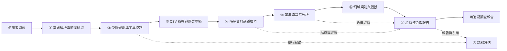
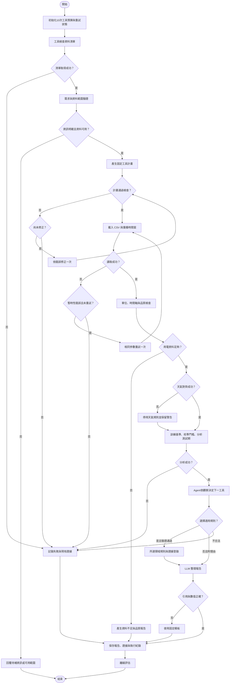

# Proposed Scheme：Energy Detective 建築用電異常調查 AI Agent

> 本節為規劃中方法，程式與實驗均尚未完成。完整工程對應、預定 CLI 與限制見 [DESIGN.md](../DESIGN.md)。所有百分位、覆蓋率、期間與呼叫上限均為暫定參數，須在測試之前固定，不是已驗證的領域標準。

## 研究方案與範圍

使用者指定建築與期間後，系統預計完成「理解問題 → 受限規劃 → CSV 資料取得 → Python 品質與時序分析 → 領域規則 → 可追溯報告」。資料採 Building Data Genome 2 的單棟建築電表與對應場址天氣子集，以歷史重播限制可見時間，模擬 IoT 量測進入分析流程；最低版本不接實體設備。

主資料選作者 repository 的 `data/meters/raw/electricity.csv`，搭配 `data/weather/weather.csv` 與 `data/metadata/metadata.csv`。raw 已經初步整理；cleaned 另刪除部分異常及零值，因此最低版本以 raw 保留可疑觀測，若額外比較 cleaned，只列為敏感度分析。資料、逐時 kWh 與當地時間說明見 [BDG2 repository](https://github.com/buds-lab/building-data-genome-project-2) 及 [Meters data features](https://github.com/buds-lab/building-data-genome-project-2/wiki/Meters-data-features)；完整來源及授權查核見 [domain_research.md](domain_research.md) 的 D3–D6。

LLM 負責需求結構化、工具選擇與報告敘述，Python 負責數值與判定。輸出應回答異常發生在哪些時間、相對歷史偏差多少、資料是否可靠，以及還需要哪些紀錄才能查核原因。總表不能確定設備根因，偏差也不能當作已節省電量。

## ①至⑧ 系統架構



1. **①需求解析與範圍驗證：**抽取建築 ID、起訖時間與調查目標，核對資料清單；缺少關鍵欄位時請使用者補充，不擅自選擇建築。
2. **②受限規劃與工具控制：**LLM 從固定工具產生結構化計畫，程式驗證 schema、依賴、資料範圍及預算並實際執行計畫。分析後再依事件與缺資料觀察，選擇適用規則或直接報告。最多 10 次工具呼叫、一次計畫修正、一次暫時性讀取重試。
3. **③CSV 取得與歷史重播：**匯入單棟公開資料，轉換電表寬表，對應場址天氣，保存來源列／欄定位。只提供重播截止點以前的資料。
4. **④時序資料品質檢查：**檢查單位、時間語意、缺值、重複、衝突、負值與時距；不補零、不以測試期插補用電。時區未知時保留原時間軸並停用作息規則。
5. **⑤基準與異常分析：**以訓練期擬合全域中位數 B0 及同星期／小時中位數 B1，在校準期固定殘差門檻，最後於測試期標記偏差並合併連續事件。
6. **⑥領域規則與假說：**將異常與歷史型態、可選作息與同時天氣對照，輸出規則條件、支持證據、缺少證據與查核建議。原因只列假說。
7. **⑦證據整合與報告：**以證據 ID 整理量測、基準、偏差與限制；檢查報告引用及數值，不通過即改用固定模板。
8. **⑧離線評估：**比較統計基準、測試合成擾動敏感度，並以固定案例評估 Agent 是否正確使用工具、引用證據及處理失敗。

## 工具定義與領域整合

| 工具 | 輸入 | 輸出與領域用途 |
|---|---|---|
| `inspect_dataset` | 登錄的本機資料 ID | 可用建築／期間、電表類型、單位、時區及版本，避免選錯分析對象 |
| `load_window` | 建築、日期、重播截止點 | 電表／天氣表與來源定位；依建築的場址關聯天氣 |
| `check_quality` | 表格參照、時距設定 | 品質摘要、有效遮罩與是否足夠；先排除資料疑點才解讀異常 |
| `analyze_energy` | 合格資料、固定時間分割與參數 | 基準、殘差、事件、MAE 與證據；數值由 Python 決定 |
| `apply_domain_rules` | 事件、歷史摘要、天氣、可選作息、`rule_ids` | 條件式規則及待查假說，缺資料則停用對應規則 |
| `build_report` | 問題、工具紀錄、唯讀證據清單 | 含引用的調查報告與限制；不支持的設備診斷不得當結論 |

所有工具回傳狀態、警告及證據 ID；失敗另回傳錯誤碼與可否重試。只接受登錄資料與型別化參數，不執行模型生成的任意程式或設備操作。證據包含方法、參數、資料版本、建築、期間、單位、數值與來源定位。

預定領域規則包括同星期／同小時偏差、使用者提供作息下的非使用時段高負載、氣溫背景及長段零值。若沒有可靠作息與當地時間，即不宣稱「非營業時間浪費」；若氣溫偏高，只建議核對空調紀錄，不判定空調故障。零值先核對通訊、停用與供電紀錄。

計畫允許選查詢範圍、偏高／偏低關注方向與候選規則；不可更改固定時間切分及統計門檻。取得事件後，Agent 可選 `apply_domain_rules` 的 `historical_deviation`、`weather_context`、`schedule_check`、`zero_run_check`，或在無事件／有明確理由時直接 `build_report`。控制器以資料前提驗證：天氣缺漏排除天氣規則，缺作息／可靠時間排除作息規則；選擇與跳過理由皆留紀錄。這些決策會改變實際呼叫及參數，並非只產生一段不執行的規劃文字。

## 完整執行流程



## 專屬演算法與 Pseudocode

預定固定 12 週視窗：8 週訓練、2 週校準、2 週測試。每段有效率暫定至少 90%，訓練期每個星期／小時組別至少 4 點；不足即產生資料不足報告。B0 使用訓練全域中位數，B1 使用訓練同星期／小時中位數；天氣僅作規則背景，最低版本不納入預測模型。

以校準期絕對殘差第 99 百分位為暫定門檻。測試期超過門檻的點為候選異常，相鄰且同方向的點合併為事件，缺測即中斷。門檻為零時僅能使用已核對的電表解析度；解析度未知則停止校準。量測單位與時間語意未明時停止分析，避免混用功率、電能及累積讀數。

### Algorithm 1：Energy Detective 受限異常調查演算法

**Input：**問題 `question`、固定設定 `config`、重播截止點 `replay_until`。

**Output：**調查報告、證據與執行紀錄，或待補資訊／資料不足／失敗狀態。

```text
01 PROCEDURE ENERGY_DETECTIVE(question, config, replay_until)
02   INIT_GUARD(tool_budget = 10, io_retry_used = FALSE, allowed_tools)
03   manifest ← GUARDED_CALL(inspect_dataset, config.dataset_id)
04   IF failed(manifest) THEN RETURN FAILURE_WITH_LOG(manifest.error)
05   request ← PARSE_AND_VALIDATE(question, manifest)
06   IF request incomplete THEN RETURN NEED_INPUT(request.missing)
07   plan ← LLM_PLAN(request, manifest, fixed_config, dependency_constraints)
08   IF invalid(plan) THEN plan ← REPAIR_ONCE(plan)
09   IF invalid(plan) THEN RETURN FAILURE_WITH_LOG("invalid_plan")
10   data ← EXECUTE_GUARDED(plan.load_window)
11   IF transient_io_error(data) THEN data ← RETRY_ONCE_GUARDED(same_parameters)
12   IF failed(data) THEN RETURN FAILURE_WITH_LOG(data.error)
13   quality, valid ← EXECUTE_GUARDED(plan.check_quality, data_reference)
14   IF unit/time unresolved OR insufficient(valid) THEN RETURN QUALITY_REPORT(quality)
15   result ← EXECUTE_GUARDED(plan.analyze_energy, valid, fixed_config)
16   INSIDE analyze_energy:
17       train, calibration, test ← FIXED_CHRONOLOGICAL_SPLIT(valid)
18       ASSERT train ends before calibration, calibration before test, test ≤ replay_until
19       FOR method IN [GLOBAL_MEDIAN, HOUR_OF_WEEK_MEDIAN]
20           baseline ← FIT(method, train only)
21           threshold ← QUANTILE(abs(calibration.value - PREDICT(baseline)), config.q)
22           IF threshold = 0 THEN threshold ← VERIFIED_RESOLUTION_OR_FAIL()
23           residual ← test.value - PREDICT(baseline); flags ← abs(residual) > threshold
24           events ← GROUP_CONSECUTIVE_SAME_DIRECTION(flags, sign(residual), break_on_missing = TRUE)
25           REGISTER_NUMERIC_EVIDENCE(method, events, data.source_rows)
26   IF failed(result) THEN RETURN FAILURE_WITH_LOG(result.error)
27   eligible ← RULES_ALLOWED_BY(result.events, weather, schedule, timezone)
28   next ← LLM_NEXT_STEP(plan, quality, result, eligible)
29   IF invalid(next) THEN RETURN RESTRICTED_REPORT_WITH_LOG()
30   IF next.tool = apply_domain_rules THEN rules ← EXECUTE_GUARDED(next)
31   ELSE ASSERT next.tool = build_report; RECORD_SKIPPED_RULES(next.reason)
32   evidence ← FREEZE(result, rules_if_any, quality, tool_log)
33   report ← GUARDED_CALL(build_report, question, evidence)
34   IF references_or_numbers_invalid(report) THEN report ← FIXED_TEMPLATE(evidence)
35   SAVE(report, evidence, config, tool_log)
36   RETURN report
37 END PROCEDURE
```

第 02 行於第一次工具呼叫之前初始化共同預算，包含 `inspect_dataset`。第 10／13／15 行執行已驗證計畫的實際工具與參數；第 27–31 行依觀察調整規則工具／直接報告分支，並檢查 eligible 與預算。資料缺欄、品質不足及演算法失敗不反覆重試。B1 為報告主要方法，B0 用於比較。

提前回傳的輔助函式仍保存現有證據與執行紀錄。規則工具失敗只輸出已驗證分析與限制；報告工具失敗使用固定模板，不補造結果。

## 可行評估

| 評估面向 | 預定方法與指標 | 解讀限制 |
|---|---|---|
| 時間切分 | 固定訓練／校準／測試，所有方法共用有效時間點；先鎖定設定再看測試結果 | 不隨機打散，不以測試期擬合、補值或調參 |
| 統計基準 | B0 對 B1：測試 MAE、覆蓋率、警示點及事件數 | MAE 反映型態擬合；警示多寡不是正確率 |
| 合成擾動 | 在有效不重疊測試區間注入尖峰 1 小時、增加 4 小時、零值 6 小時，各預定 10 件；前兩類幅度為訓練中位數 50%／100%各 5 件；固定種子且不重訓 | 中位數為零停止比例實驗；區間不足揭露實際件數；不能代替真故障 |
| 注入指標 | 點命中率＝區間內警示點／有效注入點；事件命中＝區間內至少一警示；延遲＝首次區間內警示減開始時間；完整漏失記件數且延遲 N/A | 另標原已警示點；非注入區間新增警示僅作隔離／實作檢查，不是品質或誤報指標；不宣稱真實 precision／recall |
| Agent | 10 個固定案例、各 3 次：一般 3、資訊缺少 2、資料不足 1、天氣缺漏 1、暫時 I/O 失敗 1、未知工具／越界 1、無證據根因要求 1 | 固定模型與提示詞；預期失敗案例需正確停止才能算成功 |
| 證據與執行 | 任務成功率、工具成功率、事實可追溯率、正確停止率、預算遵守率、未支持根因數；人工審閱語意 | 引用存在不代表敘述正確，必須核對數值、單位及語意 |
| 報告與規劃方法對照 | 三組：固定 Python 報表、固定流程＋LLM、受限規劃 Agent；同問題／資料／工具／B1結果可用性；比較任務成功、呼叫數、數值、完整度、追溯率與未支持根因 | Python組以既有固定模板輸出；後兩組使用同模型與報告提示詞，分離文字生成及規劃效益。固定流程取得所有適用工具結果，Agent依觀察選擇並保存規劃提示詞；不剝奪對照證據、不預設優劣、不把 B0／B1 差異歸因於 Agent |

事實可追溯率的分子為有有效證據且數值／單位相符的事實陳述，分母為全部事實陳述；無事實時記 N/A。真實資料無設備故障標籤，故不報真實故障診斷準確率、不宣稱已節電。預定結果產物為一般調查報告、資料不足案例及合成比較表；**尚未實驗，所有數值待測**。

## 實作對應與時程

| 規劃檔案 | 對應編號與工作 |
|---|---|
| `src/agent.py`、`src/main.py`、`config/experiment.json` | ①②⑦：需求、計畫、工具預算與入口 |
| `src/data.py`、`src/quality.py` | ③④：讀取、來源定位、品質、時間分割 |
| `src/analysis.py`、`src/rules.py` | ⑤⑥：基準、門檻、事件及領域規則 |
| `src/evidence.py`、`src/evaluate.py` | ⑦⑧：證據驗證、模板、固定評估 |

以上檔案均為預定配置。第 1 週完成資料核對與品質；第 2 週完成統計分析；第 3 週完成 Agent、規則與報告；第 4 週完成評估與展示。最低依賴預定為 Python、`pandas`、`numpy`、`pydantic` 與單一 LLM SDK；本機 CSV／JSON／Markdown 即可，不需向量資料庫、模型微調或雲端 IoT 平台。

預定執行介面為 `python -m src.main --config config/experiment.json --question "..."` 與 `python -m src.evaluate --config config/experiment.json`；**尚未實作，目前不可直接執行**。完整操作規劃與輸出檔案定義見 [DESIGN.md](../DESIGN.md)。
